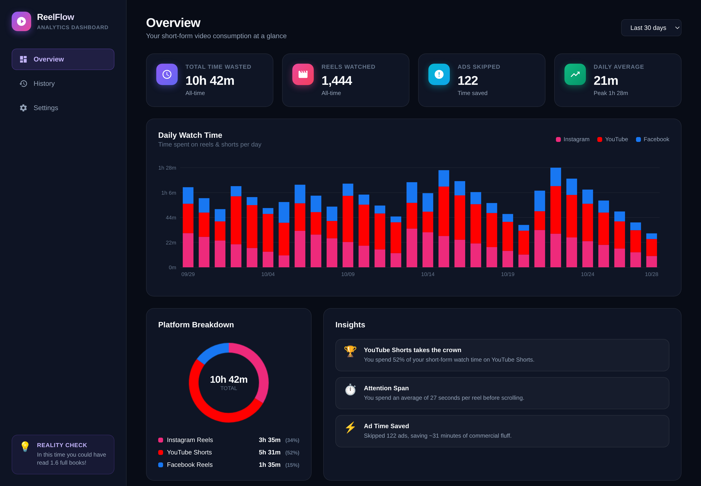
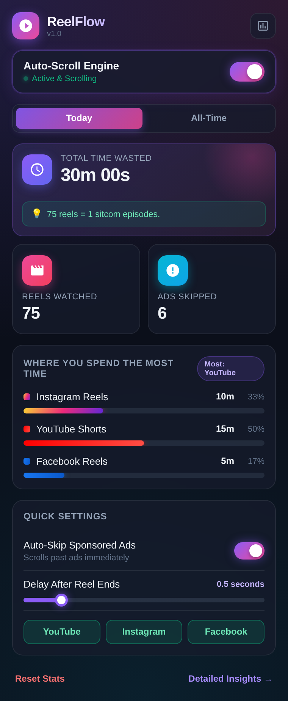

  

<h1 align="center">ReelFlow</h1>

  <b>Stop thumbing. Start watching.</b> 
  Auto-scrolls YouTube Shorts, Instagram Reels and Facebook Reels, skips ads the moment they start,
  and then shows you — honestly — how much of your day went down the feed.

  
  
  
  

## What it does

You never touch the screen. A reel ends, ReelFlow moves to the next one. Sponsored posts get
skipped before you notice them. Meanwhile every second and every reel is counted locally, and the
popup hands you the number you were trying not to look at.

| | |
| :-- | :-- |
| **Auto-scroll** | Advances Shorts and Reels on YouTube, Instagram and Facebook at a delay you choose (0.1s–3s). Never double-fires on the same video. |
| **Ad skip** | Reads the platform's own sponsored / paid-partnership labels and scrolls past them instantly, per platform. |
| **Time tracking** | Counts watch time per platform, per day, all-time. Pauses when the tab is hidden or nothing is playing. |
| **Reel counter** | How many reels you actually watched — a reel counts once, after 2.5 seconds of playback. |
| **On-page HUD** | A small overlay on the reel showing counted time and reels, so you never have to open the popup. |
| **Reality check** | Turns the total into something real: pages of a book, kilometres run, sitcom episodes. |
| **Dashboard** | 30-day stacked chart, platform breakdown, peak day, attention span, ad time saved. |
| **Privacy** | Everything lives in `chrome.storage.local`. No servers, no accounts, no analytics, no network requests at all. |

### The popup

  

One switch to start or stop, today vs all-time numbers, the platform you spend the most time on,
and the three settings that matter — ad skip, scroll delay, and which platforms are enabled.
**Detailed Insights** opens the full dashboard.

Reality check is the point of the project. Auto-scroll removes the friction that made you stop;
ReelFlow gives the friction back as a number. What you do with it is up to you.

## Install (free, no store needed)

1. Download `reelflow-v*.zip` from [Releases](../../releases/latest).
2. Unzip it somewhere permanent — the browser loads from that folder, so don't delete it later.
3. Open `chrome://extensions` (or `edge://extensions`, `brave://extensions`).
4. Turn on **Developer mode** (top right).
5. Click **Load unpacked** and pick the unzipped folder — the one with `manifest.json` in it.

That works in Chrome, Edge, Brave, Vivaldi, Opera and Arc. Updates are manual: download the new
zip, replace the folder, hit the reload icon on the extension card. If ReelFlow ever lands on a
store, installing from there switches you to automatic updates.

> Chrome, Edge and Brave will nudge you about developer-mode extensions. That is the trade for a
> $0 install.

## Browser support

| Browser | Status |
| :-- | :-- |
| Chrome · Chromium · Edge · Brave · Vivaldi · Opera · Arc | **Works** — all run the same extension engine |
| Firefox | **Not supported yet** — needs a separate Manifest V3 build |
| Safari | **Not supported** — extensions need an Xcode project |

Load-tested on Chromium 156 and Brave 1.98 (service worker starts, popup renders, no errors), and
re-tested automatically on every push. Chrome and Edge run the same engine and the same package, so
the only difference is how you install it.

## Privacy

No account, no sign-up, no servers. Stats live in your browser's local extension storage and never
leave the machine — the code makes no network requests at all. Uninstall the extension and the data
is gone.

## FAQ

**Is it really free?** Yes — no paid tier, no subscription, no "pro" upsell.

**Can I turn it off without uninstalling?** The master switch in the popup stops scrolling instantly.
You can also disable individual platforms, or turn off ad skipping only.

**Does it track what I watch?** It counts reels and seconds per platform. It does not record titles,
URLs or anything you type.

**Will it interfere with shortcuts or break the feed?** It never blocks your own input. To advance,
it clicks the site's own "next" button — or sends the same next-key the site already listens for —
and only when a reel finishes. Turn the master switch off and it does nothing at all.

## Contributing

Pull requests are welcome. The build, test and release process lives in
[CONTRIBUTING.md](CONTRIBUTING.md); the pre-release checklist is in [TESTING.md](TESTING.md).

## License

Apache 2.0 — see [LICENSE](LICENSE).
